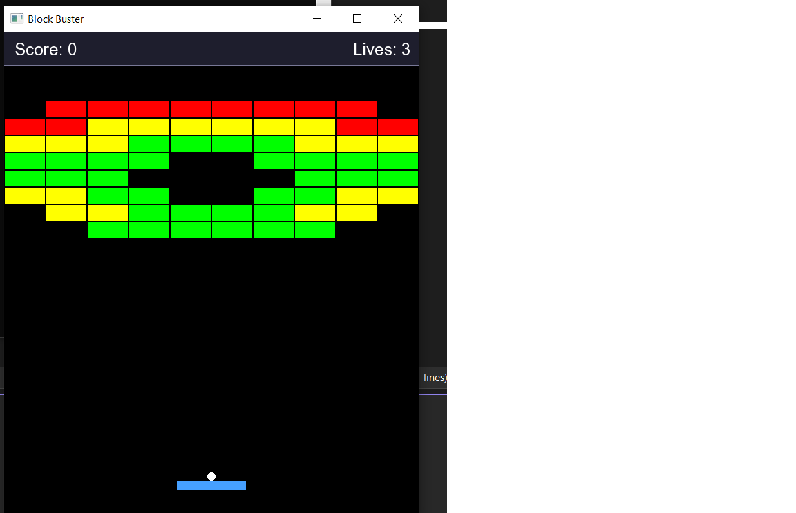

# Block Buster

A brick-breaker game made in C++ with SFML 3.
CS1002 Programming Fundamentals, FAST NUCES Lahore.

## Team
| Name | Roll No |
|------|---------|
| Fatima Qasim | L26-2500 |
| Areeza Rubab  | L26-2533 |
| Muhammad Abbas | L26-2539|

## Controls
- **A / D** or **Left / Right arrow**: move the paddle
- **Space**: launch the ball
- Close the window to quit

## How to Run
1. Install Visual Studio with the C++ desktop workload and SFML 3.0.2 (VC17, 64-bit).
2. Open `BlockBuster.slnx`, set the configuration to Debug x64.
3. Make sure `level.txt` and `font.ttf` are next to the exe (the project folder).
4. Press Ctrl+F5 to build and run.

## Features
- Level loading from `level.txt` with colour-coded bricks
- Paddle, ball launch, wall and paddle bounce
- Brick-breaking with scoring (10 per hit, 50 per break)
- Lives, win/game over messages, save game

## Screenshot

